<div align="center">


<br>

[](manifest.json)
[](https://developer.chrome.com/docs/extensions/develop/migrate/what-is-mv3)
[](popup.js)
[](#-built-with)
[](#-privacy)

**[Features](#-feature-tour)** · **[Gallery](#-gallery)** · **[How it works](#-how-it-works)** · **[Install](#-installation)** · **[Shortcuts](#%EF%B8%8F-keyboard-shortcuts)** · **[Privacy](#-privacy)**

<br>


<sub>Open the popup → name the session → save → restore any session with one click, tab groups included.</sub>

</div>

<br>

**TabSaver** is a Chrome extension for people who live in their browser. It saves a whole window (every tab, every tab group, plus a thumbnail of what you were looking at) as a named **session**. You can bring it back later, all at once or tab by tab. Everything stays on your machine.

> [!NOTE]
> Looking for the original version? Check out the [previous version of TabSaver](https://github.com/SamisDone/TabSaver).

---

## ✨ Highlights

<table>
<tr>
<td width="33%" valign="top">

### 🖼️ Visual sessions
Each session stores a thumbnail of the active tab and the favicons of its first tabs, so you can spot it at a glance.

</td>
<td width="33%" valign="top">

### 🗂️ Tab groups, kept
Chrome tab groups are saved with their **titles and colors**, and rebuilt when you restore.

</td>
<td width="33%" valign="top">

### 🎯 Selective restore
Preview any session and open only the tabs you tick.

</td>
</tr>
<tr>
<td valign="top">

### 🔄 Live Sync
Mark a session as "living" and it keeps updating itself to match your window.

</td>
<td valign="top">

### 💾 Auto-save
Rolling background backups every 15 min – 2 h. The 5 most recent are kept.

</td>
<td valign="top">

### 🧹 Duplicate cleanup
Close every duplicate tab across **all windows** in one click.

</td>
</tr>
<tr>
<td valign="top">

### 🏷️ Tags & search
Six color-coded tags, plus live search across names, tags and tab titles.

</td>
<td valign="top">

### ↩️ Undo & reorder
Undo a delete within 5 seconds. Drag and drop to reorder.

</td>
<td valign="top">

### 📦 Yours to keep
JSON export/import, a storage meter, dark mode, and zero tracking.

</td>
</tr>
</table>

---

## 🎬 Feature tour

<table>
<tr>
<td width="52%"></td>
<td valign="middle">

### 🎯 Preview & selective restore

Click a card (or its **chevron**) to see every tab in the session with its favicon and domain. Untick what you don't need, then hit **Open Selected Tabs**.

Saved tab groups are rebuilt for the tabs you open.

</td>
</tr>
<tr>
<td valign="middle">

### 🏷️ Tags & instant search

Use the **tag** button to label a session: `Work`, `Personal`, `Research`, `Shopping`, `Social` or `Entertainment`.

The search bar filters as you type. It matches **session names, tags and the titles of the tabs inside**, so searching "mdn" finds the session that has an MDN page in it.

</td>
<td width="52%"></td>
</tr>
<tr>
<td></td>
<td valign="middle">

### ➕ Add tabs to an existing session

Opened more tabs since you saved? Click **+** on a card to add the current window's tabs to it.

URLs already in the session are skipped, and the thumbnail is refreshed.

</td>
</tr>
<tr>
<td valign="middle">

### ⚙️ Auto-save & Live Sync

Open **Settings** to turn on the two background engines, each with **its own interval** (15, 30, 60 or 120 min):

- **Auto-save** creates a new snapshot session on every tick.
- **Live Sync** keeps the sessions you mark with the 🔄 button in step with your window. The icon spins while sync is on.

</td>
<td></td>
</tr>
<tr>
<td></td>
<td valign="middle">

### ↩️ Delete with undo

Deleting is never scary. A toast gives you **5 seconds to undo**, and the session goes back exactly where it was.

</td>
</tr>
<tr>
<td valign="middle">

### ↕️ Drag & drop ordering

Grab the **handle** on the left of any card and drop it where you want. Your order is saved.

<sub>Reordering is paused while a search filter is active, so nothing gets shuffled by accident.</sub>

</td>
<td></td>
</tr>
<tr>
<td>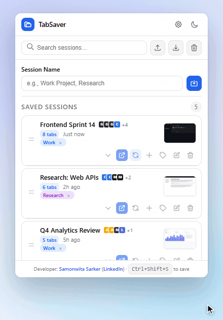</td>
<td valign="middle">

### 🌗 Light & dark themes

A shadcn-inspired design system built on HSL tokens. Flip themes with the sun/moon button and your choice is remembered.

</td>
</tr>
<tr>
<td valign="middle">

### ⌨️ Keyboard-first

<kbd>Ctrl</kbd> + <kbd>F</kbd> jumps to search and <kbd>Ctrl</kbd> + <kbd>Shift</kbd> + <kbd>S</kbd> saves the window instantly. A session saved without a name gets a timestamped one.

<kbd>Esc</kbd> closes any dialog.

</td>
<td>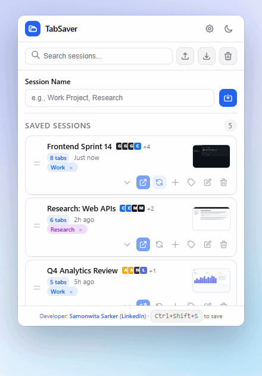</td>
</tr>
</table>

### 🧹 One-click duplicate cleanup

The cleanup button in the toolbar scans **every open window** and closes duplicate tabs, keeping the first copy of each URL. Below, the tab strip drops from 12 tabs to 8.

<div align="center">

</div>

---

## ⏱️ Auto-save vs Live Sync

The two engines are easy to mix up, so here is the difference:

<div align="center">
</div>

| | 💾 Auto-save | 🔄 Live Sync |
| :-- | :-- | :-- |
| **What it does** | Creates a **new** session each time | **Overwrites** sessions you've marked |
| **Good for** | A safety net / crash recovery | A "living" workspace that's always current |
| **Turn on** | Settings → Auto-save | Settings → Live sync **and** 🔄 on a card |
| **Interval** | 15 / 30 / 60 / 120 min | 15 / 30 / 60 / 120 min (independent) |
| **Retention** | Keeps the 5 most recent auto-saves | One session per card, always latest |
| **Naming** | `Auto-save <date> <time>`, tagged `auto` | Keeps your name and tags |

---

## 🖼 Gallery

<table>
<tr>
<td align="center" width="50%"><br><sub><b>Light</b></sub></td>
<td align="center" width="50%"><br><sub><b>Dark</b></sub></td>
</tr>
</table>

<div align="center">
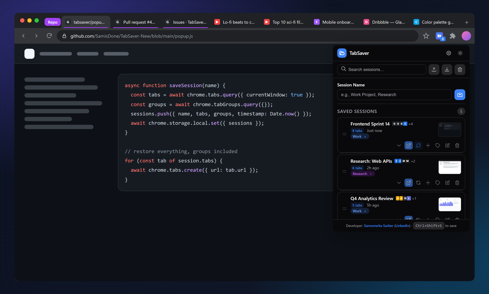
<sub>The popup sits under the toolbar icon, and the badge shows how many sessions you have.</sub>
</div>

<br>

<table>
<tr>
<td align="center" width="33%">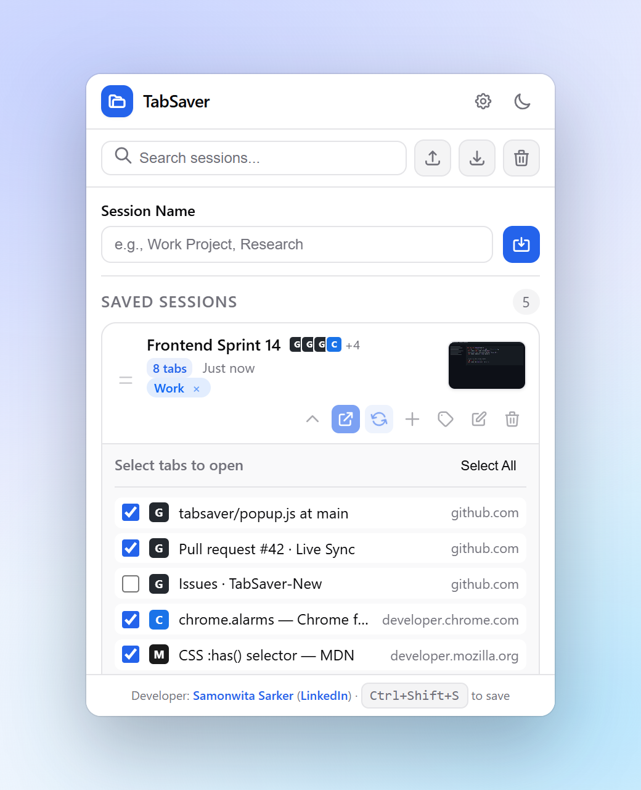<br><sub><b>Tab-by-tab preview</b></sub></td>
<td align="center" width="33%"><br><sub><b>Six color-coded tags</b></sub></td>
<td align="center" width="33%"><br><sub><b>Rename in place</b></sub></td>
</tr>
<tr>
<td align="center"><br><sub><b>"Similar session exists" warning</b><br>shown at ≥ 60% URL overlap</sub></td>
<td align="center"><br><sub><b>Storage meter</b><br>appears from 70% usage</sub></td>
<td align="center">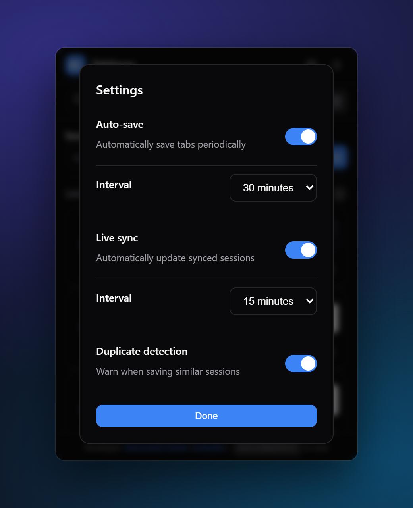<br><sub><b>Settings</b><br>two engines, independent intervals</sub></td>
</tr>
</table>

<details>
<summary><b>More screenshots</b></summary>
<br>
<table>
<tr>
<td align="center" width="50%">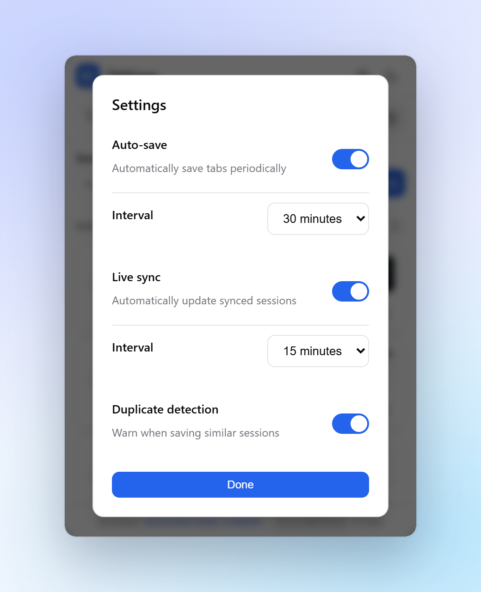<br><sub>Settings (light)</sub></td>
<td align="center" width="50%">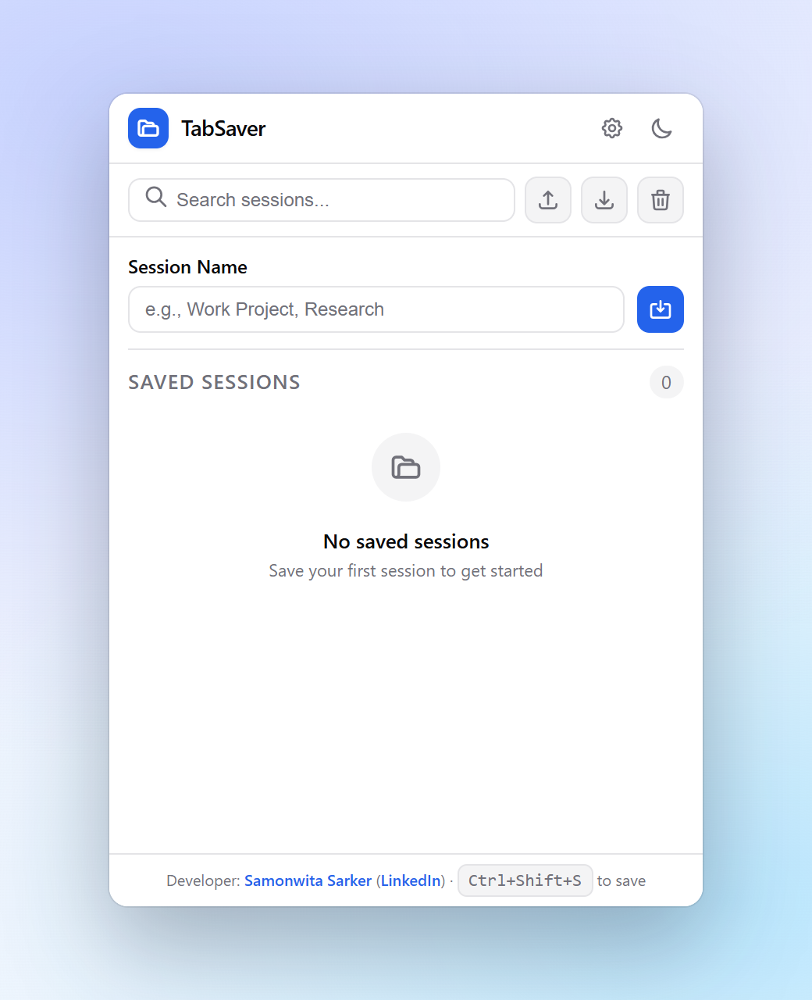<br><sub>First run / empty state</sub></td>
</tr>
</table>
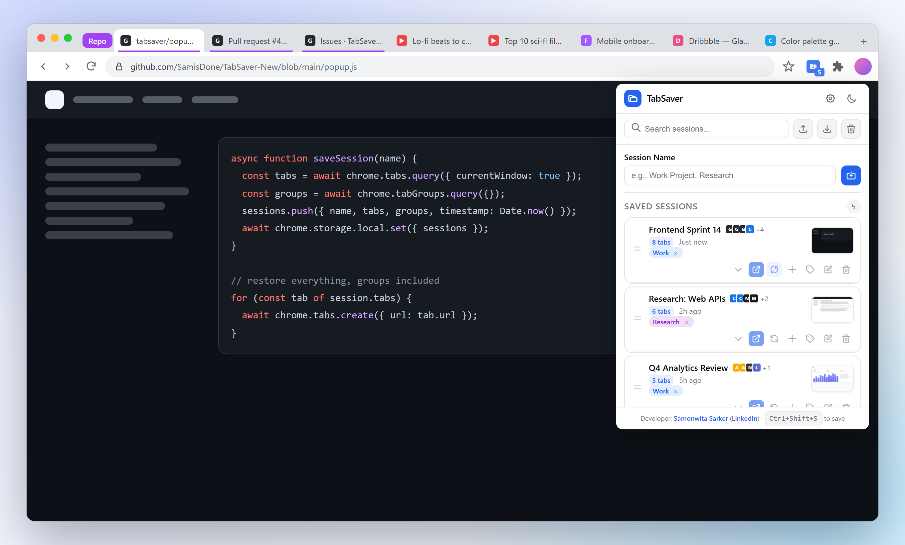
</details>

<sub><i>Demo media is recorded from the real popup code, running against sample data in a mock browser window.</i></sub>

---

## 🧠 How it works

<div align="center">
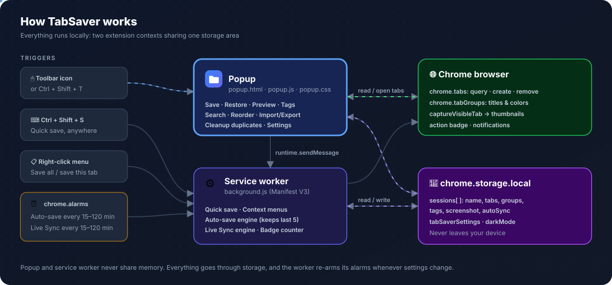
</div>

<details open>
<summary><b>💾 What happens when you click Save</b></summary>
<br>

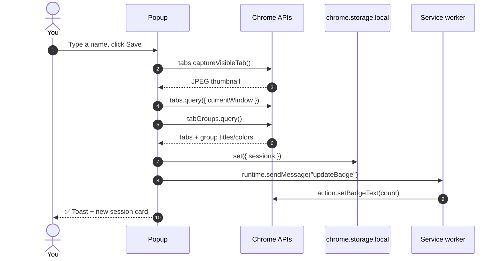

</details>

<details>
<summary><b>📂 What happens when you restore</b></summary>
<br>

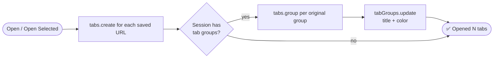

</details>

<details>
<summary><b>⏰ What the background worker does</b></summary>
<br>

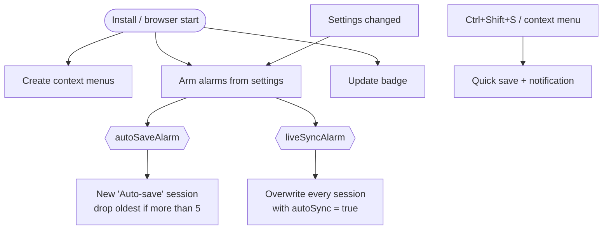

</details>

<details>
<summary><b>🗃️ Session data model</b></summary>
<br>

Every session is a plain object in `chrome.storage.local` under the `sessions` key. This is also the format used by **Export** / **Import**.

```jsonc
{
  "name": "Frontend Sprint 14",
  "timestamp": 1761800000000,          // creation time, also the session's id
  "tabCount": 8,
  "tags": ["work"],                    // work | personal | research | shopping | social | entertainment
  "autoSync": true,                    // Live Sync enabled for this session
  "screenshot": "data:image/jpeg;base64,…",
  "tabs": [
    { "title": "Pull request #42", "url": "https://github.com/…", "favIconUrl": "https://…", "groupId": 21 }
  ],
  "tabGroups": {
    "21": { "title": "Repo", "color": "purple" }
  }
}
```

</details>

---

## 🚀 Installation

TabSaver is loaded as an unpacked extension in Chrome or another Chromium browser with extension support (Edge, Brave…).

```text
 ① Get the code  ─▶  ② chrome://extensions  ─▶  ③ Developer mode ON  ─▶  ④ Load unpacked  ─▶  ⑤ Pin 📌
```

1. **Get the code.** Either clone it:
   ```bash
   git clone https://github.com/SamisDone/TabSaver-New.git
   ```
   or use **Code → Download ZIP** on this page and unzip it.
2. Open **`chrome://extensions`** (or `edge://extensions`).
3. Turn on **Developer mode** (top-right toggle).
4. Click **Load unpacked** and select the folder that contains `manifest.json`.
5. Click the 🧩 puzzle icon in the toolbar and **pin TabSaver** so it's one click away.

> [!TIP]
> To update later, `git pull` (or re-download), then hit the ↻ **reload** button on the TabSaver card in `chrome://extensions`.

---

## ⌨️ Keyboard shortcuts

| Shortcut | Where | Action |
| :-- | :-- | :-- |
| <kbd>Ctrl</kbd> + <kbd>Shift</kbd> + <kbd>S</kbd> | Anywhere in Chrome | Quick-save the current window (a notification confirms it) |
| <kbd>Ctrl</kbd> + <kbd>Shift</kbd> + <kbd>T</kbd> | Anywhere in Chrome | Open the TabSaver popup |
| <kbd>Ctrl</kbd> + <kbd>F</kbd> | Inside the popup | Focus the search bar |
| <kbd>Enter</kbd> | Session name / rename field | Save / confirm |
| <kbd>Esc</kbd> | Inside the popup | Close any open dialog |

On macOS use <kbd>⌘</kbd> instead of <kbd>Ctrl</kbd>. You can change the global shortcuts at **`chrome://extensions/shortcuts`**.

> [!IMPORTANT]
> <kbd>Ctrl</kbd> + <kbd>Shift</kbd> + <kbd>T</kbd> is also Chrome's built-in "reopen closed tab" shortcut. If you'd rather keep Chrome's behaviour, assign TabSaver a different key at `chrome://extensions/shortcuts`.

### Right-click menu

| Menu item | Appears on | Does |
| :-- | :-- | :-- |
| **Save all tabs to TabSaver** | Page & toolbar icon | Saves the whole window as a "Quick Save" session |
| **Add this tab to new session** | Page | Saves just the current tab as its own session |
| **Open TabSaver** | Toolbar icon | Opens the popup |

---

## 🧭 Card controls at a glance

| Control | What it does |
| :-- | :-- |
| ☰ **Handle** | Drag to reorder |
| ⌄ **Chevron** / click card | Expand the tab-by-tab preview |
| ↗ **Open** (blue) | Restore every tab, with groups |
| 🔄 **Sync** | Toggle Live Sync for this session |
| ➕ **Add** | Add the current window's new tabs to this session |
| 🏷️ **Tag** | Add a category tag (click × on a tag to remove it) |
| ✏️ **Rename** | Rename the session |
| 🗑️ **Delete** | Delete, with a 5-second undo |

**Toolbar:** ⬆ Export JSON · ⬇ Import JSON · 🧹 Close duplicate tabs · ⚙️ Settings · 🌙 Theme

For a step-by-step walkthrough of every feature, see **[FEATURES.md](FEATURES.md)**.

---

## 🔒 Privacy

- **No servers, no analytics, no accounts.** TabSaver never sends your data anywhere. The only network traffic is your browser loading the favicons of saved tabs.
- All sessions, settings and thumbnails live in `chrome.storage.local` on your device.
- Export files are written only where you choose to save them.

Full policy: **[privacy policy.md](privacy%20policy.md)**

<details>
<summary><b>Why each permission is needed</b></summary>
<br>

| Permission | Used for |
| :-- | :-- |
| `tabs` | Reading tab titles, URLs and favicons to save them; opening and closing tabs |
| `activeTab` | Capturing the thumbnail of the tab you're looking at |
| `tabGroups` | Saving and recreating tab-group titles and colors |
| `storage` | Keeping sessions and settings on your device |
| `alarms` | Running Auto-save and Live Sync on schedule |
| `contextMenus` | The right-click "Save to TabSaver" entries |
| `notifications` | Confirming a quick save made with the keyboard shortcut or right-click menu |

</details>

---

## 🛠 Built with

<table>
<tr>
<td align="center" width="25%"><br><sub>Semantic popup markup</sub></td>
<td align="center" width="25%"><br><sub>HSL design tokens, light/dark, micro-animations</sub></td>
<td align="center" width="25%"><br><sub>No frameworks, no build step</sub></td>
<td align="center" width="25%"><br><sub>Service worker + alarms</sub></td>
</tr>
</table>

```text
TabSaver-New/
├── manifest.json      # MV3 manifest: permissions, shortcuts, service worker
├── background.js      # Service worker: auto-save, live sync, context menus, badge
├── popup.html         # Popup markup + dialogs (rename, tags, settings)
├── popup.css          # shadcn-inspired design system, light & dark
├── popup.js           # All popup logic: save/restore, search, tags, drag & drop…
├── icons/             # Extension icon (PNG + SVG source)
├── assets/            # README media: banner, diagrams, screenshots, GIFs
├── FEATURES.md        # Detailed how-to for every feature
└── privacy policy.md
```

---

## 📝 Changelog

| Version | Changes |
| :-- | :-- |
| **2.1.2** | Session names are visible on cards again (actions moved to their own row). The popup footer is no longer clipped. The active Live Sync button is highlighted. Docs refreshed. |
| **2.1.0** | **Add tabs** to existing sessions. **Live Sync**, with its own interval, independent of Auto-save. |
| **2.0** | Redesigned UI with visual thumbnails, duplicate-tab cleanup, tab-group support, tags, search, export/import, undo, drag & drop and dark mode. |

---

## 👤 Developer

<table>
<tr>
<td>

**Samonwita Sarker**

[](https://github.com/SamisDone)
[](https://www.linkedin.com/in/samonwita-sarker-a87737262/)

</td>
</tr>
</table>

<div align="center">

<br>

**If TabSaver saves you from tab chaos, consider giving it a ⭐**

<sub>Created with a focus on performance, privacy, and productivity.</sub>

</div>
