# TabSaver

A Chrome extension that saves the tabs in a window as a named session and reopens them later, tab groups included. Sessions, settings and thumbnails stay in your browser.

Version 2.1.2 · Manifest V3 · plain HTML, CSS and JavaScript, no dependencies

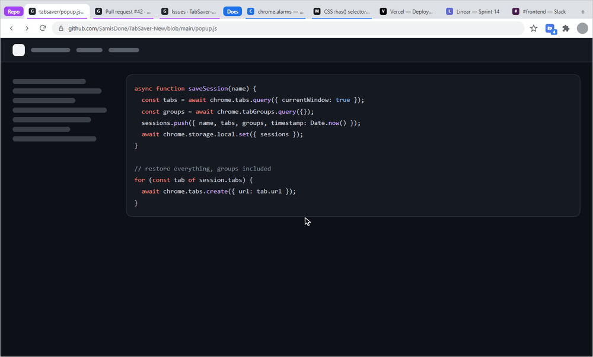

The original version is at [SamisDone/TabSaver](https://github.com/SamisDone/TabSaver).

## Saving and restoring

Type a name and press save, or hit <kbd>Ctrl</kbd>+<kbd>Shift</kbd>+<kbd>S</kbd> anywhere in Chrome. TabSaver records every tab in the window, the title and colour of each tab group, and a screenshot of the tab you were looking at. The blue open button on a card brings it all back.

Click a card to see the tabs inside it. Untick the ones you don't need and press **Open Selected Tabs**. If you've opened more tabs since saving, the **+** button adds them to the session and skips any it already has.

<p>
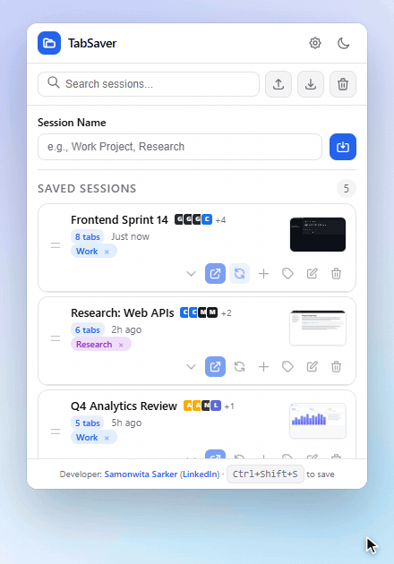
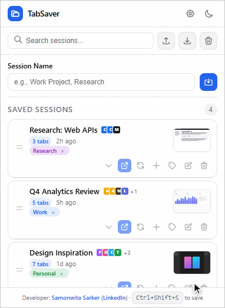
</p>

## Keeping sessions organised

Each session can carry tags: Work, Personal, Research, Shopping, Social and Entertainment. The search box matches session names, tags and the titles of the tabs inside each session, so typing "mdn" finds the session with an MDN page in it.

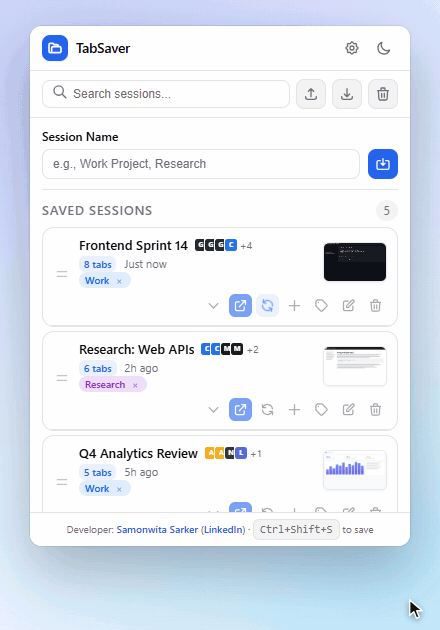

Drag a card by its handle to move it. Deleting a session shows an undo button for five seconds.

<p>
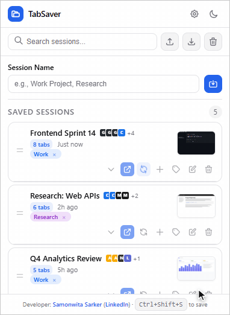

</p>

## Saving in the background

Settings has two switches. Each runs on its own interval of 15, 30, 60 or 120 minutes, even with the popup closed.

- **Auto-save** saves the window as a new session on every interval and keeps the five newest.
- **Live Sync** overwrites the sessions you've marked with the sync button so they match your window.

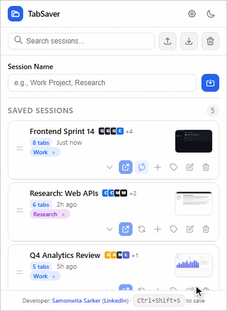

<picture>
  <source media="(prefers-color-scheme: dark)" srcset="assets/diagrams/engines-dark.svg">
  
</picture>

## Closing duplicate tabs

The trash button in the toolbar closes every tab whose URL is already open somewhere else, across all windows. The first copy stays open. Here it takes the window from twelve tabs to eight.

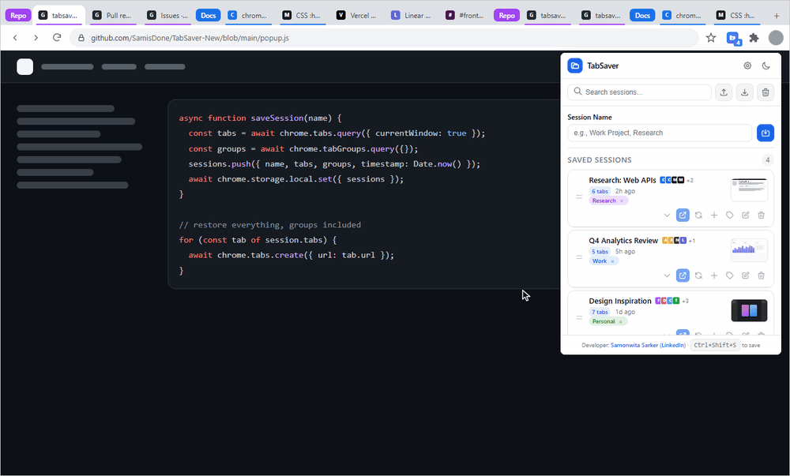

## Screenshots

<p>
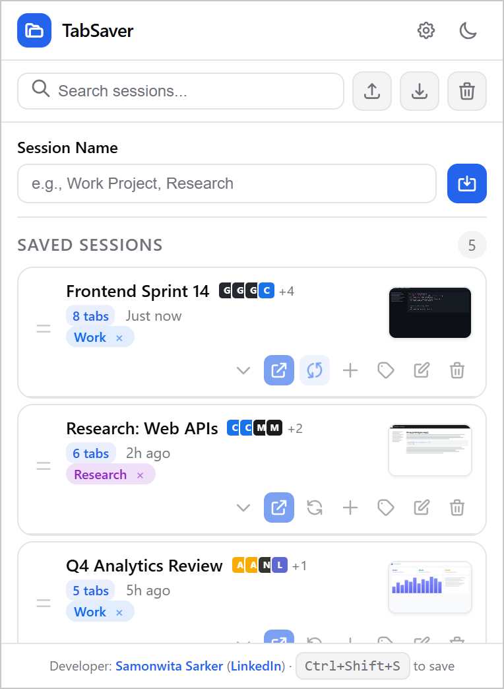
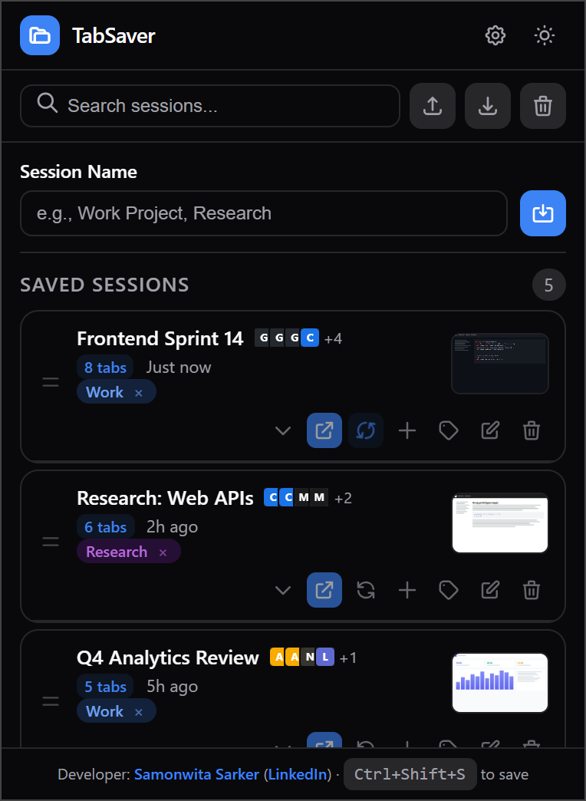
</p>

If the window you're about to save shares 60% or more of its URLs with an existing session, a warning names that session. A storage bar appears once local storage is 70% full.

<p>
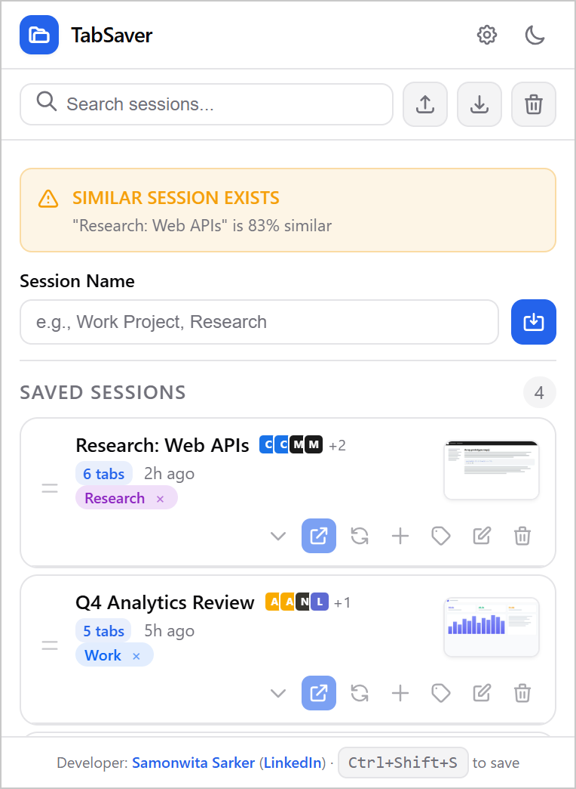
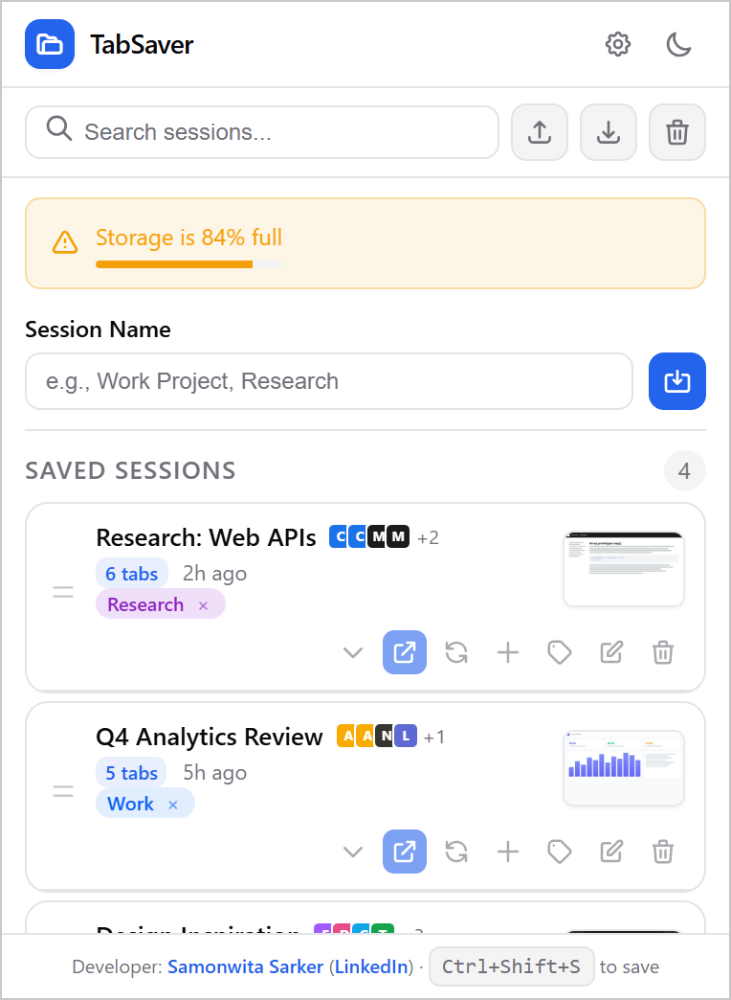
</p>

<p>
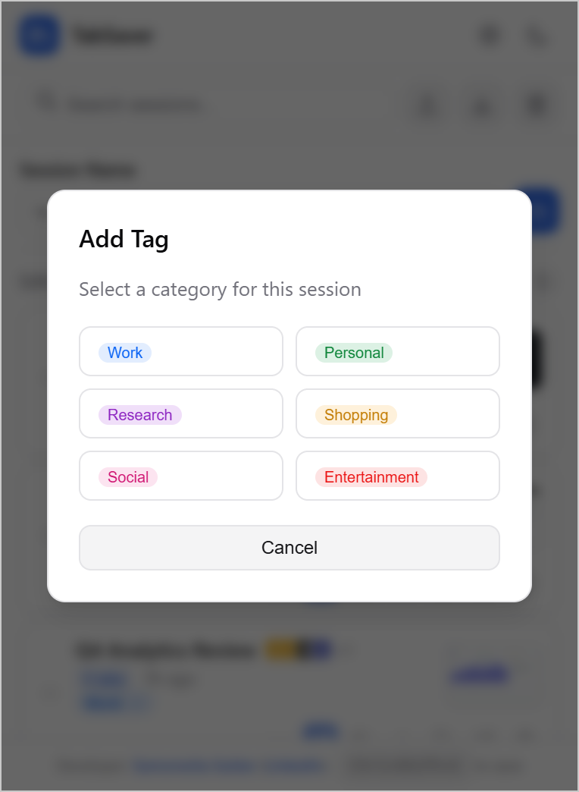
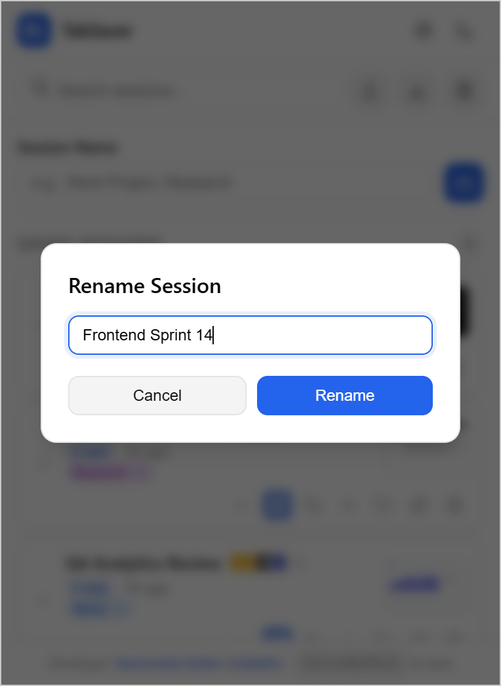
</p>

## How it works

<picture>
  <source media="(prefers-color-scheme: dark)" srcset="assets/diagrams/architecture-dark.svg">
  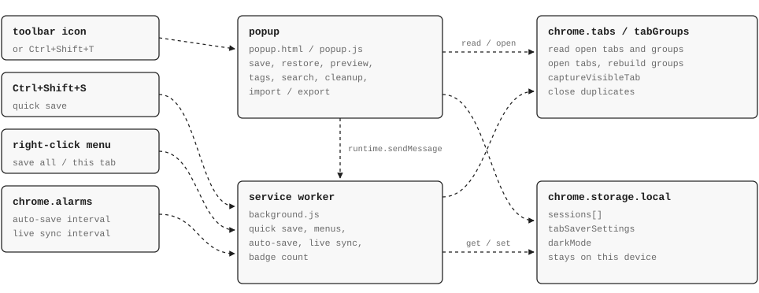
</picture>

The popup and the service worker don't share memory, so everything goes through `chrome.storage.local`. The worker handles the keyboard shortcut, the right-click menu and the two alarms. It re-arms the alarms whenever the settings change and keeps the toolbar badge in sync with the number of sessions.

Restoring opens each saved URL with `chrome.tabs.create`, then regroups the tabs with `chrome.tabs.group` and restores each group's title and colour.

Sessions are stored as plain objects, and the same shape is used for export and import:

```jsonc
{
  "name": "Frontend Sprint 14",
  "timestamp": 1761800000000,   // creation time, also used as the id
  "tabCount": 8,
  "tags": ["work"],
  "autoSync": true,             // Live Sync on for this session
  "screenshot": "data:image/jpeg;base64,...",
  "tabs": [
    { "title": "Pull request #42", "url": "https://github.com/...", "favIconUrl": "https://...", "groupId": 21 }
  ],
  "tabGroups": {
    "21": { "title": "Repo", "color": "purple" }
  }
}
```

## Installing

1. Clone the repository, or download it with **Code → Download ZIP** and unzip it.
   ```bash
   git clone https://github.com/SamisDone/TabSaver-New.git
   ```
2. Go to `chrome://extensions` and turn on **Developer mode**.
3. Click **Load unpacked** and choose the folder that contains `manifest.json`.
4. Pin TabSaver from the extensions menu so it sits in the toolbar.

To update, pull the latest code and press reload on the TabSaver card in `chrome://extensions`.

## Shortcuts

| Keys | Where | Does |
| :-- | :-- | :-- |
| <kbd>Ctrl</kbd>+<kbd>Shift</kbd>+<kbd>S</kbd> | Anywhere in Chrome | Save the current window |
| <kbd>Ctrl</kbd>+<kbd>Shift</kbd>+<kbd>T</kbd> | Anywhere in Chrome | Open TabSaver |
| <kbd>Ctrl</kbd>+<kbd>F</kbd> | In the popup | Focus search |
| <kbd>Esc</kbd> | In the popup | Close a dialog |

Use <kbd>⌘</kbd> instead of <kbd>Ctrl</kbd> on a Mac. <kbd>Ctrl</kbd>+<kbd>Shift</kbd>+<kbd>T</kbd> is also Chrome's "reopen closed tab" shortcut. You can change either shortcut at `chrome://extensions/shortcuts`.

Right-clicking a page gives you **Save all tabs to TabSaver** and **Add this tab to new session**.

## Permissions

| Permission | Why |
| :-- | :-- |
| `tabs` | Read titles, URLs and favicons; open and close tabs |
| `activeTab` | Take the thumbnail of the tab you're on |
| `tabGroups` | Save and rebuild tab groups |
| `storage` | Keep sessions and settings on your device |
| `alarms` | Run auto-save and Live Sync on schedule |
| `contextMenus` | The right-click entries |
| `notifications` | Confirm a save made from the shortcut or right-click menu |

## Privacy

There are no accounts, analytics or servers. Everything is stored in `chrome.storage.local` and never sent anywhere. The only network requests are your browser loading the favicons of saved tabs. The full policy is in [privacy policy.md](privacy%20policy.md).

## Files

```text
manifest.json       permissions, shortcuts, service worker
background.js       quick save, context menus, auto-save, live sync, badge
popup.html          popup markup and dialogs
popup.css           styles, light and dark
popup.js            popup logic
icons/              extension icon
assets/             images used in this README
FEATURES.md         step-by-step guide to every feature
privacy policy.md
```

## Changelog

**2.1.2.** Session names show on every card again, the popup footer is no longer cut off, and sessions with Live Sync on are highlighted.

**2.1.0.** The + button for adding tabs to an existing session, and Live Sync, with its own interval separate from auto-save.

**2.0.** Redesign with thumbnails, duplicate cleanup, tab groups, tags, search, export and import, undo, drag and drop, and dark mode.

## Author

Samonwita Sarker · [GitHub](https://github.com/SamisDone) · [LinkedIn](https://www.linkedin.com/in/samonwita-sarker-a87737262/)
